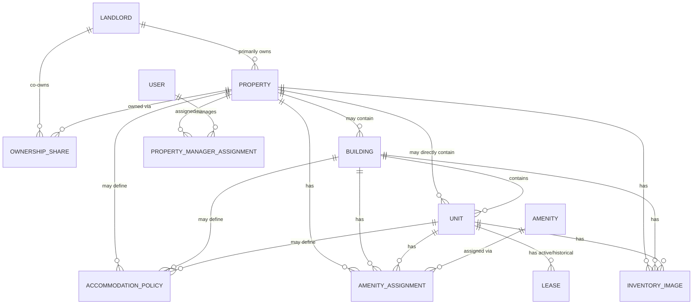

# Domain Model Review — Residential Property Inventory

Status: Review complete; business-owner decisions confirmed 2026-11-24.
This document does **not** change any approved decision, requirement,
schema or migration. It records the review findings, the agreed
residential inventory model, the confirmed inventory decisions (Section 8),
and the approved structural decisions SR-1–SR-6 with remaining questions
("Consolidated Approval Position").

Scope: residential properties only. No commercial property management is
introduced.

Reviewed against:
- Root `AGENTS.md`, `apps/api/AGENTS.md`, `apps/web/AGENTS.md`.
- `docs/architecture/domain-model.md`, `docs/architecture/data-model.md`.
- `docs/requirements/business-requirements.md`,
  `docs/requirements/functional-requirements.md`,
  `docs/requirements/business-rules.md`.
- `docs/architecture/system-workflows.md` (the task's
  `docs/workflows/system-workflows.md`; actual path used).
- `docs/architecture/permissions-matrix.md`.
- ADRs 001–007 and `docs/decisions/decision-and-risk-register.md`.

---

## 1. Review of the Existing Domain Model

### 1.1 What is well modelled

- **Hierarchy direction is correct.** `Property → optional Building →
  Unit`, with a unit able to attach directly to a property (standalone
  house), matches the residential requirement (domain-model invariants
  8; data-model `units.property_id` + nullable `building_id`).
- **Unit container denormalization** (`units.property_id` alongside
  `building_id`) is a good decision for landlord/property isolation
  queries (BR-AUTH-003).
- **Amenity lookup + assignment** pattern is appropriate for a variable
  set of features (water, parking, security, furnished, balcony, garden).
- **Rental price split** — `units.standard_rent` (asking/standard) vs
  `leases.rent_amount` (agreed) — is correct: unit rent is a listing
  attribute, lease rent is the financial truth.
- **Ledger separation** (charges/payments/allocations/penalties,
  append-only, derived balances) is sound and unchanged.
- **Money** as `numeric(12,2)` + `Prisma.Decimal` (ADR-005) is correct.

### 1.2 Weaknesses in the current inventory model

The current `properties` / `buildings` / `units` tables are **thin**.
They cover ownership, a name/address blob, GPS and basic unit economics,
but they do **not** yet carry most of the required inventory fields
(type, reference, structured address, building floor count, unit number/
room/house number, floor, size, deposit requirement, description,
internal notes, assigned manager). The inventory requirements are
currently only partially represented.

Specific gaps are enumerated in Section 2.

### 1.3 Complexity assessment (50–100 properties)

- The overall shape is **not over-engineered** for a modular monolith at
  this scale. PostgreSQL + Prisma + a handful of lookup tables is
  proportionate.
- Two areas risk **unnecessary complexity** and are flagged for
  simplification or deferral:
  - **Polymorphic child tables** (`*_assignments`, `accommodation_policies`,
    `property_images` with three nullable FK columns + a `level` enum).
    These are hard to constrain in Postgres/Prisma and add branching in
    every query.
  - **Co-ownership (`ownership_shares`)** may be premature if most
    properties are single-owner; it can be deferred without blocking the
    core inventory.

---

## 2. Identified Inconsistencies and Missing Relationships

Severity: **H** = blocks correct inventory, **M** = should fix before
implementation, **L** = polish.

| # | Finding | Severity | Recommendation |
| --- | --- | --- | --- |
| F1 | `properties` has no `type` (property classification). | H | Add `property_type` enum. |
| F2 | `properties` has no `reference`/code and no `description`. | H | Add `reference` (unique) + `description`. |
| F3 | Address is a single `jsonb/text` blob; county/town/neighbourhood/street are not structured, hurting search/filter. | H | Replace with structured columns. |
| F4 | `buildings` lacks `floor_count`, `building_type`, `description`. | M | Add fields. |
| F5 | `units` lacks `unit_number` (vs generic `label`), `room_number`, `house_number`, `floor`, `size_value`/`size_unit`, `deposit_required`, `description`. | H | Add fields; keep `unit_number` as primary label. |
| F6 | `units.type` is free text; no unit-type enum. | M | Introduce `unit_type` enum. |
| F7 | **No unit-number uniqueness** within its parent container. | H | Add uniqueness constraint on (container, unit_number). |
| F8 | **No assigned-manager relationship.** Permissions matrix refers to "assigned" scope but no `property_managers`/assignment table exists. | H | Add property↔manager assignment. |
| F9 | **No internal notes** field on property/building/unit. | M | Add `notes` text. |
| F10 | Deposit exists only on `leases`; requirement lists a **deposit requirement at unit level**. | M | Add `units.deposit_required` (expected) separate from lease actual. |
| F11 | `amenity_assignments` / `accommodation_policies` / `property_images` use 3 nullable FK columns + `level`; level-consistency and "one primary" constraints are awkward with NULLs. | M | Consolidate to a single `owner_id` + `level` (+ `property_id` for scoping). |
| F12 | ~~`gender_policy` enum ambiguous~~ **RESOLVED**: `ANY` = unrestricted eligibility (not shared accommodation); `MALE_ONLY`/`FEMALE_ONLY` the only restrictions. Property type and gender are separate fields. | — | Confirmed by business owner. |
| F13 | No controlled vocabularies for property/building/unit types. | M | Define three separate enums (Section 5). |
| F14 | Unit attribute changes (e.g. `standard_rent`) are not audited; no history. | L | Log to `audit_logs`; versioning not required (charges derive from lease). |
| F15 | Availability is only `VACANT/OCCUPIED/MAINTENANCE`; no `RESERVED`/`UNAVAILABLE`. | L | Confirm whether more states are needed. |
| F16 | `properties.reference` uniqueness scope undefined (global vs per landlord). | M | Decide in Section 8. |
| F17 | Amenity `name` is globally unique; no category to distinguish features vs utilities. | L | Add optional `category`. |

---

## 3. Recommended Residential Property Inventory Model

### 3.1 Design decisions

1. **Keep** `Property → Building (optional) → Unit`, with a unit
   attaching to exactly one container. Keep `units.property_id`
   denormalized for isolation queries.
2. **Structured address** on the property (not a blob):
   `county`, `town`, `neighbourhood`, `street_address`.
3. **Three separate type classifications** (Section 5): `property_type`,
   `building_type`, `unit_type`.
4. **Replace polymorphic 3-column children** with a single `owner_id` +
   `level` (+ `property_id` for scoping) for amenities, policies and
   images. This makes constraints expressible and queries uniform.
5. **Two-tier price**: unit holds `standard_rent` + `deposit_required`
   (listing/expected); lease holds `rent_amount` + `deposit_amount`
   (agreed, financial truth).
6. **Manager assignment** via `property_managers(property_id, user_id)`.
7. **Co-ownership** (`ownership_shares`) — **deferred** (confirmed);
   single primary `landlord_id` initially.

### 3.2 Recommended relationships

### 3.3 Why not EAV/JSON for policies

The accommodation-policy set (gender, students, families, children,
pets, shared, max occupants) is **small, stable and known**. Structured
columns with controlled enums give validation, indexing and simple
queries. A JSONB/EAV approach would add complexity without benefit at
50–100 properties. Structured columns (the current approach) are
recommended; only the "one primary owner" representation is simplified.

---

## 4. Proposed Field Specification

Types: `uuid`, `text`, `varchar(n)`, `enum(...)`, `int`, `smallint`,
`numeric(p,s)`, `boolean`, `date`, `timestamptz`.
"Req" = Required; "Opt" = Optional.

### 4.1 `properties`

| Field | Data type | Req | Validation |
| --- | --- | --- | --- |
| id | uuid PK | Req | app-assigned |
| reference | varchar(32) | Req | **globally unique**; uppercase alnum + dash |
| name | varchar(200) | Req | non-empty |
| property_type | enum(`property_type`) | Req | must be a residential type |
| description | text | Opt | ≤ 2000 chars |
| county | varchar(80) | Req | non-empty (Kenyan county) |
| town | varchar(120) | Opt | |
| neighbourhood | varchar(120) | Opt | |
| street_address | varchar(200) | Opt | |
| latitude | numeric(9,6) | Opt | −90..90; both-or-neither with longitude |
| longitude | numeric(9,6) | Opt | −180..180 |
| landlord_id | uuid FK landlords | Req | primary owner (isolation) |
| notes | text | Opt | internal only |
| created_at / updated_at | timestamptz | Req | |

### 4.2 `buildings`

| Field | Data type | Req | Validation |
| --- | --- | --- | --- |
| id | uuid PK | Req | |
| property_id | uuid FK properties | Req | |
| name | varchar(120) | Req | unique within property |
| building_type | enum(`building_type`) | Opt | |
| floor_count | smallint | Opt | ≥ 0 |
| description | text | Opt | ≤ 2000 chars |
| notes | text | Opt | |
| created_at / updated_at | timestamptz | Req | |

### 4.3 `units`

| Field | Data type | Req | Validation |
| --- | --- | --- | --- |
| id | uuid PK | Req | |
| property_id | uuid FK properties | Req | denormalized; must equal building's property |
| building_id | uuid FK buildings | Opt | null ⇒ sits directly on property |
| unit_number | varchar(32) | Req | unique within container (F7) |
| room_number | varchar(32) | Opt | |
| house_number | varchar(32) | Opt | |
| floor | smallint | Opt | ≥ 0 |
| unit_type | enum(`unit_type`) | Req | |
| bedrooms | smallint | Opt | ≥ 0 |
| bathrooms | smallint | Opt | ≥ 0 |
| size_value | numeric(8,2) | Opt | > 0 |
| size_unit | enum(`SQM`,`SQFT`) | Opt | required if size_value set |
| standard_rent | numeric(12,2) | Req | ≥ 0 |
| deposit_required | numeric(12,2) | Opt | ≥ 0 (expected deposit; actual agreed deposit on lease) |
| status | enum(`VACANT`,`OCCUPIED`,`MAINTENANCE`) | Req | see F15 |
| description | text | Opt | ≤ 2000 chars |
| notes | text | Opt | |
| created_at / updated_at | timestamptz | Req | |

Validation: at least one of `unit_number`/`room_number`/`house_number`
present (recommended: `unit_number` always present as the label).

### 4.4 `property_managers` (new)

| Field | Data type | Req | Validation |
| --- | --- | --- | --- |
| id | uuid PK | Req | |
| property_id | uuid FK properties | Req | |
| user_id | uuid FK users | Req | role `PROPERTY_MANAGER` |
| is_primary | boolean | Opt | default false |
| created_at | timestamptz | Req | |

Unique `(property_id, user_id)`. A property may have **multiple**
managers; at most one `is_primary = true` per property (partial unique
index).

### 4.5 `amenities`

| Field | Data type | Req | Validation |
| --- | --- | --- | --- |
| id | uuid PK | Req | |
| name | varchar(80) | Req | unique |
| category | enum(`FEATURE`,`AMENITY`,`UTILITY`) | Opt | |
| active | boolean | Req | default true |

### 4.6 `amenity_assignments` (recommended single owner_id)

| Field | Data type | Req | Validation |
| --- | --- | --- | --- |
| id | uuid PK | Req | |
| amenity_id | uuid FK amenities | Req | |
| level | enum(`PROPERTY`,`BUILDING`,`UNIT`) | Req | |
| owner_id | uuid | Req | the property/building/unit id |
| property_id | uuid FK properties | Req | scoping/isolation |
| created_at | timestamptz | Req | |

Unique `(amenity_id, level, owner_id)`.

### 4.7 `accommodation_policies` (recommended single owner_id)

| Field | Data type | Req | Validation |
| --- | --- | --- | --- |
| id | uuid PK | Req | |
| level | enum(`PROPERTY`,`BUILDING`,`UNIT`) | Req | |
| owner_id | uuid | Req | |
| property_id | uuid FK properties | Req | scoping |
| gender_policy | enum(`ANY`,`MALE_ONLY`,`FEMALE_ONLY`) | Opt | `ANY` = unrestricted eligibility (open to everyone). Confirmed. |
| students_allowed | boolean | Opt | null = unspecified/inherit |
| families_allowed | boolean | Opt | |
| children_allowed | boolean | Opt | |
| pets_allowed | boolean | Opt | |
| smoking_allowed | boolean | Opt | |
| shared_allowed | boolean | Opt | |
| max_occupants | smallint | Opt | ≥ 1 |
| visitors_policy | text | Opt | |
| created_at / updated_at | timestamptz | Req | |

### 4.8 `inventory_images` (recommended single owner_id)

| Field | Data type | Req | Validation |
| --- | --- | --- | --- |
| id | uuid PK | Req | |
| level | enum(`PROPERTY`,`BUILDING`,`UNIT`) | Req | |
| owner_id | uuid | Req | |
| property_id | uuid FK properties | Req | scoping |
| storage_key | varchar(512) | Req | external object storage key |
| caption | varchar(200) | Opt | |
| is_primary | boolean | Req | default false; ≤ 1 per (level, owner_id) |
| sort_order | int | Req | default 0, ≥ 0 |
| uploaded_at | timestamptz | Req | |

---

## 5. Recommended Controlled Values

Residential only. Three independent vocabularies.

### 5.1 `property_type` (whole property) — **Confirmed**

Business owner confirmed the following residential property types (as
reviewed):

`APARTMENT`, `BEDSITTER`, `STUDIO`, `SINGLE_ROOM`, `SHARED`,
`MAISONETTE`, `BUNGALOW`, `TOWNHOUSE`, `STANDALONE_HOUSE`.

Modelling rule (confirmed): **property type and gender eligibility are
independent fields.** An apartment, bedsitter, etc. can be gender-neutral
(`ANY`), male-only or female-only. "Shared accommodation" is a property
*type*; "shared occupancy" is a separate policy attribute — do not conflate
them.

If a new type is needed later, add it via a reviewed migration; no value
is invented now.

### 5.2 `building_type` — **Confirmed**

`BLOCK`, `WING`, `ROW`, `DETACHED`, `OTHER`.

### 5.3 `unit_type` — **Confirmed**

`BEDSITTER`, `STUDIO`, `SINGLE_ROOM`, `SHARED_ROOM`, `ONE_BEDROOM`,
`TWO_BEDROOM`, `THREE_BEDROOM`, `MAISONETTE`, `BUNGALOW_UNIT`,
`TOWNHOUSE_UNIT`, `HOUSE`, `OTHER`.

`HOUSE` was **added by business-owner approval (2026-11-24)** to represent
a standalone non-bungalow house as a rentable unit, so houses are not
forced into `BUNGALOW_UNIT` or `OTHER`. The nine `property_type` values are
unchanged. Property type and unit type remain **separate classifications**
(an apartment property contains units of various unit types); the two
vocabularies are not merged.

### 5.4 `gender_policy` — **Confirmed**

`ANY` (unrestricted — open to everyone regardless of gender),
`MALE_ONLY`, `FEMALE_ONLY`.

Confirmed: "gender-neutral" means **unrestricted gender eligibility**.
It does **not** mean a shared-accommodation arrangement where male and
female tenants are expected to live together. Shared occupancy is a
separate `shared_allowed` policy attribute, not part of `gender_policy`.

These are **recommendations**; final values need business-owner approval.

---

## 6. Recommendations: Amenities, Policies, Images

### 6.1 Amenities — **Confirmed**

- **One catalogue** with a `category` enum: `FEATURE`, `AMENITY`,
  `UTILITY`. (E.g. furnished/parking/security = `FEATURE`; water/
  electricity = `UTILITY`; borehole/lift = `AMENITY`.)
- Keep **lookup + assignment**; assign at property/building/unit via a
  single `owner_id` + `level` (Section 4.6).
- Seed a starter catalogue; allow admins to extend.

### 6.2 Accommodation policies

- Keep **structured columns + enums** (Section 4.7).
- Booleans are **nullable** to mean "unspecified / inherit from parent
  level"; resolution is most-specific-wins (unit → building → property).
- `gender_policy = ANY` means **unrestricted eligibility** (confirmed),
  not mixed-gender shared living. Shared occupancy is the separate
  `shared_allowed` attribute.

### 6.3 Images — **Confirmed**

- **No binaries in PostgreSQL**; store `storage_key` referencing object
  storage. **Provider to be selected before implementation.**
- Use a single `owner_id` + `level` model (Section 4.8) with
  `property_id` for isolation; **multiple images per level** allowed.
- Enforce **at most one primary** per `(level, owner_id)`.
- `sort_order` controls display order; `uploaded_at` records provenance.
- Validate storage keys and content type at upload time (service-level).

---

## 7. Database Constraints & Indexes

### 7.1 Constraints

- **Unit container consistency**: `building_id` is null OR
  `building.property_id = units.property_id`. Enforce with a composite
  FK `(building_id, property_id)` referencing `buildings(id, property_id)`
  (requires a unique constraint on `buildings(id, property_id)`), or a
  trigger.
- **Unit number uniqueness within container**: because `building_id` is
  nullable, use a generated column
  `container_id uuid GENERATED ALWAYS AS (COALESCE(building_id, property_id)) STORED`
  and `UNIQUE (container_id, unit_number)`. (Prisma needs a raw SQL
  migration for the generated column + partial/unique index.)
- **GPS**: `CHECK (latitude BETWEEN -90 AND 90)`,
  `CHECK (longitude BETWEEN -180 AND 180)`,
  `CHECK ((latitude IS NULL) = (longitude IS NULL))`.
- **Size**: `CHECK (size_value IS NULL OR size_value > 0)`,
  `CHECK (size_value IS NULL OR size_unit IS NOT NULL)`.
- **Counts**: `CHECK (bedrooms >= 0)`, `CHECK (bathrooms >= 0)`,
  `CHECK (floor >= 0)`, `CHECK (floor_count >= 0)`,
  `CHECK (max_occupants >= 1)`.
- **Level/owner consistency** (amenities, policies, images): with a
  single `owner_id`, add `CHECK` that `owner_id IS NOT NULL`; validate
  the owning row exists at the stated level in the service (Postgres
  cannot FK to three tables).
- **One primary image**: partial unique index
  `UNIQUE (level, owner_id) WHERE is_primary`.
- **Manager role**: enforce `user.role = PROPERTY_MANAGER` in service.
  A property may have **multiple** `property_managers` rows, at most one
  with `is_primary = true` (partial unique index
  `UNIQUE (property_id) WHERE is_primary`).
- **Financial rows**: existing `RESTRICT` FK behaviour; append-only.
- **Attribute auditing**: writes to rent, ownership, unit status and
  accommodation policies append an `audit_logs` row (actor, entity,
  before/after summary). Audited, not versioned.
- **Co-ownership**: **deferred** — do not build `ownership_shares` now.
  Single primary `properties.landlord_id` drives isolation. If added
  later: `CHECK (share_percent > 0 AND share_percent <= 100)` and
  per-property sum ≤ 100.

### 7.2 Indexes

- `properties(landlord_id)` (isolation).
- `properties(county, town, neighbourhood)` (location filtering).
- `properties(property_type)`, `properties(reference)` unique.
- `buildings(property_id)`.
- `units(property_id)`, `units(building_id)`, `units(unit_type)`,
  `units(status)`, `units(standard_rent)`, `units(container_id, unit_number)` unique.
- `property_managers(user_id)`, `property_managers(property_id)`.
- `amenity_assignments(owner_id)`, `amenity_assignments(amenity_id)`.
- `accommodation_policies(owner_id)`.
- `inventory_images(owner_id)`, partial unique `(level, owner_id) WHERE is_primary`.
- Optional GIN full-text index on `properties(name, street_address,
  neighbourhood)` and `units(unit_number)` for search.

---

## 8. Decisions — Confirmed by Business Owner

All inventory decisions below were confirmed on 2026-11-24. These are no
longer open. (Penalty formula and payment allocation order remain
blocked and out of scope for this inventory review.)

| # | Decision | Confirmed outcome |
| --- | --- | --- |
| 1 | Gender eligibility | `ANY` = unrestricted eligibility (open to everyone); `MALE_ONLY`/`FEMALE_ONLY` the only restrictions. Not shared accommodation. |
| 2 | Deposit model | **Both**: expected deposit at unit level; actual agreed deposit on lease. |
| 3 | Property types | 9 residential types (Section 5.1). Separate from gender eligibility. |
| 4 | Building types | `BLOCK`, `WING`, `ROW`, `DETACHED`, `OTHER` (Section 5.2). |
| 5 | Unit types | Retain proposed vocabulary (Section 5.3), subject to property/unit classification separation. |
| 6 | Co-ownership | **Deferred**; single primary landlord initially. `ownership_shares` not built now. |
| 7 | Assigned managers | **Multiple managers per property**, one **optional primary** manager. |
| 8 | Staff role | Keep roles extensible; **no unnecessary roles yet** (no dedicated accountant/staff role now). |
| 9 | Internal notes | Readable by **admin and assigned managers only**. |
| 10 | Address | `county` **required**; `town`, `neighbourhood`, `street_address` optional. |
| 11 | Unit identifiers | **Require** a unit label/number; `room_number` and `house_number` optional. |
| 12 | Unit size | Optional; support both `SQM` and `SQFT`. |
| 13 | Availability | `VACANT`, `OCCUPIED`, `MAINTENANCE` initially; `RESERVED` considered later. |
| 14 | Property reference | **Globally unique**. |
| 15 | Amenities/features | **One catalogue** with categories `FEATURE`, `AMENITY`, `UTILITY`. |
| 16 | Image storage | Object storage; provider selected **before implementation**; multiple images per level. |
| 17 | Attribute auditing | Audit important changes, especially **rent, ownership, status and accommodation policies**. |

> Penalty formula (ADR-006) and payment allocation order (ADR-005) remain
> **Blocked/Pending** and are explicitly **out of scope** for this
> inventory review; do not implement them.

---

## 9. Proposed Implementation Sequence

Implementation is **not** part of this review. The Section 8 decisions
are confirmed, so the sequence below may begin when implementation work
is authorized. Suggested order:

1. **Enums & seed data**: `property_type`, `building_type`, `unit_type`,
   amenity catalogue with categories. (Prisma enums + seed script.)
2. **Landlord + Property**: structured address, GPS, globally-unique
   reference, description, notes. (Co-ownership deferred — single primary
   landlord.)
3. **Building**: with `building_type`, `floor_count`, uniqueness within
   property.
4. **Unit**: with `unit_number`, floor, type, size, rent, deposit,
   status, and the **container uniqueness** constraint (raw SQL
   migration).
5. **Property-manager assignments** + authorization scoping.
6. **Amenities + assignments** (single `owner_id` model).
7. **Accommodation policies** (structured columns, most-specific-wins
   resolution).
8. **Images** (single `owner_id` model + storage integration).
9. **Authorization & isolation tests** (landlord isolation, manager
   scope, tenant scope).
10. **Search/filter** endpoints (county/town/type/bedrooms/rent/
    availability/amenity).
11. **Tenancy & ledger** (lease, charges) — separate, later milestone.

Each step: migration (`--create-only` + edit SQL where needed), service
+ repository, Zod validation, Swagger, tests (validation, authorization,
uniqueness, isolation).

---

## 10. Decisions Needing Approval Before Implementation

**None outstanding for the inventory model.** All 17 decisions in
Section 8 were confirmed on 2026-11-24. The field specification
(Section 4), vocabularies (Section 5) and constraints (Section 7) are
now the agreed basis for implementation.

Remaining **implementation-time** items (not business decisions, do not
block sign-off):

1. Select the object-storage provider before implementing image upload
   (Section 8, row 16).
2. Decide whether to add `RESERVED` availability later (Section 8, row 13).
3. Consider adding a dedicated staff/accountant role later if a concrete
   need emerges (Section 8, row 8).

The inventory tables (Section 4) may now be implemented as migrations
once the implementation sequence (Section 9) begins.

---

## Second Review — Structural Decisions

Status: read-only second review (2026-11-24). This section **does not
change** any approved decision, requirement, schema, migration or code.
It records analysis, options and recommendations. Where a recommendation
would refine the first-review proposal (Section 4), it is flagged as
requiring approval and is **not** applied.

Cross-cutting constraints honoured: PostgreSQL + Prisma, TypeScript
strict, modular monolith, exact money, backend authorization with
landlord/property scoping, historical preservation, no microservices, no
invented business rules, penalty/allocation out of scope.

---

### SR-1. Does `property_type` belong to Property, or to Unit?

**Problem.** The nine approved types (`APARTMENT`, `BEDSITTER`,
`STUDIO`, `SINGLE_ROOM`, `SHARED`, `MAISONETTE`, `BUNGALOW`,
`TOWNHOUSE`, `STANDALONE_HOUSE`) are a mix of **property-level**
typologies (an apartment block, a bedsitter block) and **dwelling/unit**
typologies (a bedsitter, a studio, a maisonette). If the same word is used
at both levels without a clear rule, the model becomes ambiguous: is
`BEDSITTER` describing the whole property or an individual room? The
vocabulary must not change; only the **owning entity and semantics** must
be pinned down.

**Practical examples.**

| Scenario | Property (`property_type`) | Building (`building_type`) | Units (`unit_type`) |
| --- | --- | --- | --- |
| Apartment block, mixed units | `APARTMENT` | `BLOCK` | `BEDSITTER`, `ONE_BEDROOM`, `TWO_BEDROOM` |
| Bedsitter block | `BEDSITTER` | `BLOCK` | `BEDSITTER` ×N |
| Standalone bungalow, one tenant rents all | `BUNGALOW` | (none) | one unit, e.g. `TWO_BEDROOM` (no `HOUSE` type) |
| Standalone house split into rooms | `STANDALONE_HOUSE` | (none) | `SINGLE_ROOM` ×4 |
| Shared house (unrelated tenants) | `SHARED` | (none) | `SHARED_ROOM` ×N; `shared_allowed = true` |
| Townhouse row | `TOWNHOUSE` | `ROW` | `TOWNHOUSE_UNIT` ×N |

The examples show that the nine types can describe the **whole property**
(apartment block, bedsitter block, townhouse row) **and** the **rentable
unit** (bedsitter, studio, maisonette). Both readings are legitimate, so
the ambiguity is real.

**Options considered.**

- **A. `property_type` on Property only; `unit_type` on Unit only
  (complementary, intentionally overlapping vocabulary).**
  `property_type` classifies the property *typology* (what kind of
  property this is overall, for listing/search/reporting);
  `unit_type` classifies each rentable unit's layout. The same word may
  appear at both levels but they are different fields with different
  meaning. — *Simple, matches the confirmed "separate fields" rule,
  supports property-level search and unit-level search.*
- **B. Move the nine types to Unit; derive property type from units.**
  Property type becomes a rollup (e.g. dominant unit type). — *Removes
  duplication but loses the ability to classify a property that is a
  single dwelling or an estate, and makes property search depend on
  unit aggregation.*
- **C. Keep both but make `property_type` mandatory and `unit_type`
  mandatory, with a documented mapping.** — *Same as A plus a validation
  matrix; strongest consistency, slightly more governance.*

**Recommended solution.** **Option A (with C's documentation).**
`property_type` is a **Property-only** attribute describing the property
typology. `unit_type` remains a **Unit-only** attribute describing the
rentable unit. Neither moves to the other entity. The overlapping words
are acceptable because they are applied at different levels with
different meaning. Document the intended semantics per level and provide
the example matrix above as the authoritative interpretation guide.

**Database implications.** No schema change: `properties.property_type`
(enum) and `units.unit_type` (enum) already live on their own entities
(Section 4.1/4.3). Add a documented validation guideline (service-level,
not a hard rule): e.g. a `STANDALONE_HOUSE` property normally has one or
few units; an `APARTMENT` property normally has ≥1 building or many
units. Do **not** add a hard constraint that couples them, because
legitimate exceptions exist (a bedsitter block vs a bedsitter unit).

**Decisions still requiring approval.**
1. Confirm interpretation: `property_type` = property typology,
   `unit_type` = rentable unit layout (both retained, separate).
2. How to classify a **whole standalone house** as a unit when the
   `unit_type` vocabulary has no `HOUSE` value (use bedroom count, e.g.
   `TWO_BEDROOM`, or `OTHER`). Vocabulary is unchanged; this is an
   application rule.
3. Whether `SHARED` as a `property_type` is redundant with the
   `shared_allowed` policy attribute and `SHARED_ROOM` unit type; confirm
   the intended distinction (property operated as shared accommodation vs
   per-unit shared-occupancy permission vs a room within shared housing).

---

### SR-2. Polymorphic `owner_id + level` vs relationship tables vs nullable FKs

**Problem.** The first review proposed a single `owner_id uuid` + `level
enum` (plus mandatory `property_id` for scoping) for
`amenity_assignments`, `accommodation_policies` and `inventory_images`.
A plain `owner_id` cannot carry a PostgreSQL foreign key, so referential
integrity and Prisma relations are lost. The alternatives are separate
relationship tables or nullable foreign-key columns.

**Options considered.**

| Option | Referential integrity | Prisma compatibility | Maintainability | Notes |
| --- | --- | --- | --- | --- |
| **A. Polymorphic `owner_id` + `level`** (current proposal) | **None** — no FK to property/building/unit. Orphans possible. | Weak — plain scalar; no relation navigation; manual owner lookup. | One table, but conditional logic everywhere; risk of level mixing. | Cheapest to write; weakest guarantees. |
| **B. Separate relationship tables** (e.g. `property_amenities`, `building_amenities`, `unit_amenities`, ×3 for policies/images = up to 9 tables) | **Full** — real FKs, `ON DELETE` per table. | **Strong** — native relations. | Simple per-table, but 3× duplication and more migrations. | Overkill at 50–100 properties; building-level is rare. |
| **C. Nullable FK columns** (`property_id` mandatory + `building_id`/`unit_id` nullable + `level` + CHECK) | **Full** — FKs to all three parents. | **Strong** — optional relations to each parent. | One table; a CHECK enforces level/column consistency; a generated `target_id` gives a clean uniqueness key. | Best balance. |

**Recommended solution.** **Option C** — replace the polymorphic
`owner_id` with **nullable foreign-key columns**:

- `property_id uuid NOT NULL` (always present; isolation anchor).
- `building_id uuid NULL`, `unit_id uuid NULL` (the specific target).
- `level enum(PROPERTY, BUILDING, UNIT)`.
- CHECK enforcing exactly one target per level:
  - `PROPERTY` → `building_id IS NULL AND unit_id IS NULL`
  - `BUILDING` → `building_id IS NOT NULL AND unit_id IS NULL`
  - `UNIT` → `unit_id IS NOT NULL AND building_id IS NULL`
- Generated column for uniqueness:
  `target_id uuid GENERATED ALWAYS AS (CASE level WHEN 'PROPERTY' THEN property_id WHEN 'BUILDING' THEN building_id WHEN 'UNIT' THEN unit_id END) STORED`.
- Reject Option A (no integrity, poor Prisma) and Option B (too much
  duplication for the scale; building-level rows are rare).

This **refines** the first-review proposal (Section 4.6–4.8); it is not
applied until approved.

**Database implications.**

- Real FKs: `building_id → buildings(id)`, `unit_id → units(id)`,
  `property_id → properties(id)`. Add composite FKs so a building/unit
  cannot be attached under the wrong property:
  `FOREIGN KEY (building_id, property_id) REFERENCES buildings(id, property_id)`
  and `FOREIGN KEY (unit_id, property_id) REFERENCES units(id, property_id)`
  (requires `UNIQUE (id, property_id)` on `buildings`/`units`).
- One-primary uniqueness via generated `target_id`:
  `CREATE UNIQUE INDEX uq_primary_<table> ON <table> (level, target_id) WHERE is_primary;`
  (applies to `inventory_images`; amenities/policies do not have a
  primary flag).
- Prisma: generated columns and partial indexes need a raw SQL migration
  (`prisma migrate --create-only` then edit). Optional relations to all
  three parents remain navigable.
- Deletion behaviour: `RESTRICT` on financial/important rows; operational
  children may `CASCADE` only where non-financial (deferred to
  implementation).

**Decisions still requiring approval.**
1. Approve Option C (nullable FKs + `target_id`) over the polymorphic
   `owner_id` and over separate tables.
2. Confirm composite-FK approach requires `UNIQUE (id, property_id)` on
   `buildings` and `units`.

---

### SR-3. `properties.landlord_id` and `ownership_shares`

**Problem.** `properties.landlord_id` (primary owner) and
`ownership_shares` (co-owners) can conflict if both are treated as
authoritative. The initial implementation must support **one landlord
per property** without painting co-ownership into a corner.

**Options considered.**

- **A. `landlord_id` only; add shares later.** `landlord_id NOT NULL` is
  the single owner and the isolation anchor. Co-ownership deferred. —
  *Simplest; matches confirmed deferral.*
- **B. `ownership_shares` only (no `landlord_id`).** Every property has
  ≥1 share. — *More "correct" long-term but forces every query to join
  shares for isolation, and complicates the common single-owner case.*
- **C. Both now, with `landlord_id` as primary and shares optional.** —
  *Flexible but more surface area now; shares still unused.*

**Recommended solution.** **Option A.** Keep
`properties.landlord_id uuid NOT NULL` as the **primary owner and
isolation anchor** (BR-AUTH-003). Do **not** create `ownership_shares`
in the initial migration. Preserve the future path by:

- Centralising the ownership check behind one helper
  (`isLandlordOfProperty(landlordId, propertyId)`) that today compares
  `property.landlord_id` and can later also consult `ownership_shares`
  without touching call sites.
- Documenting that `landlord_id` is the **access/isolation anchor**,
  while future `ownership_shares` would carry **economic** shares
  (statement/expense allocation). Access for co-owners would be an
  explicit future decision.

**Database implications.** `properties.landlord_id` FK `NOT NULL`,
`ON DELETE RESTRICT`, indexed (already in Section 7). No new table now.
Future `ownership_shares(property_id, landlord_id, share_percent)` can be
added by additive migration with `share_percent numeric(5,2)` and a
per-property sum ≤ 100 check.

**Decisions still requiring approval.**
1. Confirm `landlord_id` is the sole access/isolation anchor initially.
2. Future: will co-owners (shares) be granted portal access, or only the
   primary landlord? (Defer; do not assume.)

---

### SR-4. Unit-number uniqueness for attached and directly attached units

**Problem.** Units attach either to a building (`building_id` set) or
directly to a property (`building_id NULL`). Uniqueness of a unit
label/number must hold **within the correct parent** without collisions
across parents.

**Options considered.**

- **A. Generated `container_id = COALESCE(building_id, property_id)` +
  `UNIQUE (container_id, unit_number)`.** — *Correct; one index; but
  needs a generated column and raw SQL.*
- **B. Two partial unique indexes:**
  `UNIQUE (building_id, unit_number) WHERE building_id IS NOT NULL` and
  `UNIQUE (property_id, unit_number) WHERE building_id IS NULL`. —
  *Correct; no generated column; expresses intent directly; still raw
  SQL for partial indexes.*
- **C. Single `UNIQUE (property_id, building_id, unit_number)`.** —
  *Wrong: NULL `building_id` makes rows distinct in Postgres, so two
  direct units with the same number would both be allowed.*

**Recommended solution.** **Option B** (two partial unique indexes). It
is correct for both cases, avoids a generated column, and is easy to
reason about. Validate `unit_number` non-empty (`length(btrim(unit_number)) > 0`).

**Worked examples.**

- Block A unit `1` and Block B unit `1`: allowed (different
  `building_id`).
- Block A cannot have two units numbered `1` (partial unique on
  `building_id`).
- A standalone house with two direct rooms both numbered `1`: rejected
  (partial unique on `property_id` where `building_id IS NULL`).
- A property with both a building and a direct unit both labelled `1`:
  **allowed** under Option B (different `container_id`). Confirm whether
  that is acceptable or whether direct units should be disallowed when a
  property has buildings.

**Database implications.** Two partial unique indexes (raw SQL
migration). Optional generated `container_id` column if a single index
is preferred (Option A). Add `CHECK` that `unit_number` is non-blank.

**Decisions still requiring approval.**
1. Approve Option B (two partial unique indexes).
2. Are units allowed to attach directly to a property that also has
   buildings? If not, add a rule; if yes, confirm duplicate labels across
   a building and the property are acceptable.
3. Should labels be unique across the whole property (e.g. prefix
   building), or only within the immediate container?

---

### SR-5. Should unit availability be derived or manually maintained?

**Problem.** `units.status` (`VACANT`/`OCCUPIED`/`MAINTENANCE`) is
currently a manually maintained column. Occupancy is fully determined by
leases, so a manual status can drift from reality. Maintenance is an
operational state that is **not** derivable from leases.

**Options considered.**

- **A. Keep manual `status`.** — *Simple reads, but drift risk and a
  second source of truth beside leases.*
- **B. Derive occupancy from leases; keep a separate operational
  override for maintenance.** — *Authoritative; no drift for occupancy;
  maintenance handled explicitly.*
- **C. Cache `status` transactionally** (update on lease create/end) plus
  a reconciliation job. — *Fast reads; still needs sync discipline.*

**Recommended solution.** **Option B, with an optional cached column.**

- **Occupancy is derived:** a unit is `OCCUPIED` iff it has an `ACTIVE`
  lease; otherwise `VACANT`. The partial unique index "one active lease
  per unit" already enforces the invariant.
- **Maintenance/off-market is an operational override**, not a lease
  fact: model as `units.is_off_market boolean NOT NULL DEFAULT false`
  (and later optionally a reason/`RESERVED`). A unit can be vacant **and**
  off-market.
- **Availability is a read model:**
  - active lease → `OCCUPIED`
  - else `is_off_market` → `MAINTENANCE`
  - else → `VACANT`
- Optionally keep a denormalised `status` column **only** as a cache for
  list filtering, kept in sync inside the same transaction as lease
  create/end and the off-market flag, with a periodic reconciliation.
  The **authoritative** value remains derived.

**Database implications.**

- Postgres generated columns cannot reference another table, so
  occupancy cannot be a stored generated column. Provide it via a
  **view** (`unit_availability` joining `units` + active `leases` +
  `is_off_market`) or compute in the service/repository.
- Add `units.is_off_market boolean NOT NULL DEFAULT false` (and index it
  for availability filtering).
- If a cached `status` is kept, add a reconciliation job; otherwise drop
  the manual `status` column to avoid two truths.

**Decisions still requiring approval.**
1. Approve derived occupancy (active lease) as authoritative.
2. Model maintenance as an `is_off_market` override vs a separate
   `unit_availability_overrides` table.
3. Whether to cache `status` for read performance or always derive via
   view/service.
4. `RESERVED` remains deferred (per prior confirmation).

---

### SR-6. `building_type` and `unit_type` overlap review (no vocabulary change)

**Problem.** `building_type` (`BLOCK`, `WING`, `ROW`, `DETACHED`,
`OTHER`) and `unit_type` (`BEDSITTER`, `STUDIO`, `SINGLE_ROOM`,
`SHARED_ROOM`, `ONE_BEDROOM`, `TWO_BEDROOM`, `THREE_BEDROOM`,
`MAISONETTE`, `BUNGALOW_UNIT`, `TOWNHOUSE_UNIT`, `OTHER`) overlap with
each other and with the nine `property_type` values. This review must
identify overlaps **without changing the approved vocabulary**.

**Observed overlaps / inconsistencies.**

| Overlap | Where it appears | Why it matters |
| --- | --- | --- |
| `MAISONETTE`, `BUNGALOW`, `TOWNHOUSE`, `SHARED` | `property_type` **and** `unit_type` (`MAISONETTE`, `BUNGALOW_UNIT`, `TOWNHOUSE_UNIT`, `SHARED_ROOM`) | Same word at two levels; must be applied consistently. |
| `DETACHED` (building) vs `STANDALONE_HOUSE`/`BUNGALOW` (property) | A detached building is effectively a standalone house. | Risk of modelling the same physical thing as either a `STANDALONE_HOUSE` property with no building, or a property with a `DETACHED` building. |
| `ROW` (building) vs `TOWNHOUSE` (property) vs `TOWNHOUSE_UNIT` (unit) | A townhouse row contains townhouse units. | Three levels describe one concept; needs a consistent pattern. |
| `SHARED` (property) vs `shared_allowed` (policy) vs `SHARED_ROOM` (unit) | Triple meaning of "shared". | Ambiguous; see SR-1 decision 3. |
| No `HOUSE` / `APARTMENT_UNIT` in `unit_type` | A whole standalone house as one unit, or an apartment unit. | Whole-dwelling units must fall back to bedroom count or `OTHER`. |

**Recommended solution (no vocabulary change).**

1. **Pin the level semantics** and publish the mapping matrix (SR-1
   table plus building/unit columns) as the authoritative guide:
   - `property_type` = property typology.
   - `building_type` = physical structure of a building within the
     property.
   - `unit_type` = layout of the rentable unit.
2. **Consistent pattern for townhouses:** property `TOWNHOUSE` → building
   `ROW` (optional) → unit `TOWNHOUSE_UNIT`. For a single townhouse, the
   property may be `TOWNHOUSE` with one `TOWNHOUSE_UNIT` and no building.
3. **Consistent pattern for maisonettes/bungalows:** property
   `MAISONETTE`/`BUNGALOW` with a single unit of the matching unit type;
   a multi-unit building uses `BLOCK` + mixed unit types.
4. **Document that identical words at different levels are intentional**,
   not duplication to be "fixed" — but must be populated per the matrix.
5. **Record the gaps** (`HOUSE`, `APARTMENT_UNIT`, `DETACHED` vs
   `STANDALONE_HOUSE`) as interpretation notes, not vocabulary changes.

**Database implications.** None. Enums remain as approved. Optionally add
service-level validation warnings (not hard constraints) for atypical
combinations (e.g. `BEDSITTER` property with a `BLOCK` building and
`TWO_BEDROOM` units).

**Decisions still requiring approval.**
1. Confirm the level-semantics interpretation and the townhouse /
   maisonette / bungalow patterns above.
2. How to represent a whole standalone house as a unit (bedroom count vs
   `OTHER`) — no new vocabulary.
3. Whether `DETACHED` building type is used at all, or standalone houses
   are always modelled as a property with no building.

---

### Summary of decisions requested from the business owner

1. **SR-1:** Confirm `property_type` = Property typology, `unit_type` =
   Unit layout; how to type a whole standalone-house unit; clarify
   `SHARED` vs `shared_allowed` vs `SHARED_ROOM`.
2. **SR-2:** Approve nullable-FK design (Option C) over polymorphic
   `owner_id` and separate tables; approve composite FKs.
3. **SR-3:** Confirm `landlord_id` as sole initial access/isolation
   anchor; defer co-owner access rule.
4. **SR-4:** Approve two partial unique indexes; confirm whether direct
   units are allowed in a property with buildings; label scope.
5. **SR-5:** Approve derived occupancy + `is_off_market` override; decide
   cache vs view; maintenance modelling.
6. **SR-6:** Confirm level-semantics interpretation and dwelling
   patterns; confirm no vocabulary change.

None of these changes an approved business decision; they refine the
**structural** design and must be approved before implementation.

---

## Consolidated Approval Position — Structural Decisions (2026-11-24)

The business owner reviewed the Second Review and approved the following.
This section records the **approved** decisions and, separately, the
**remaining questions**. It does not change any earlier approved business
decision and does not authorise implementation.

### Approval summary

| Decision | Position |
| --- | --- |
| SR-1 | **Approved with clarification** (house/shared) |
| SR-2 | **Approved** — Option C with DB constraints |
| SR-3 | **Approved** — single landlord; co-ownership deferred |
| SR-4 | **Approved** — partial indexes + direct units |
| SR-5 | **Approved with refinement** — derived occupancy; prefer read-model |
| SR-6 | **Approved** — proposed level semantics, no new values |

### SR-1 — Property type and unit type (Approved with clarification)

**Approved:**
- `property_type` stays at **Property** level and describes the overall
  property.
- `unit_type` stays at **Unit** level and describes the individual
  rentable accommodation.
- Retain the nine approved property types and the existing proposed unit
  types.
- `SHARED` (property), `SHARED_ROOM` (unit) and `shared_allowed`
  (policy) are **three distinct concepts**:
  - `SHARED` property = property classified as shared accommodation.
  - `SHARED_ROOM` unit = a room intended for shared occupancy.
  - `shared_allowed` = whether sharing is permitted.
- Do **not** assume every unit in a `SHARED` property is shared.

**Examples (approved):**

| Property | Property type | Unit type |
| --- | --- | --- |
| Bedsitter block | `BEDSITTER` | `BEDSITTER` |
| Apartment block | `APARTMENT` | `ONE_BEDROOM` |
| Apartment block | `APARTMENT` | `TWO_BEDROOM` |
| Standalone bungalow | `BUNGALOW` | `BUNGALOW_UNIT` |
| Townhouse development | `TOWNHOUSE` | `TOWNHOUSE_UNIT` |

**Resolved (2026-11-24):** `HOUSE` **is added** to `unit_type` (nine
`property_type` values unchanged). Examples:
`STANDALONE_HOUSE` + `BUNGALOW_UNIT` (bungalow), `STANDALONE_HOUSE` +
`HOUSE` (non-bungalow house), `APARTMENT` + `ONE_BEDROOM`. This avoids
forcing every standalone house into `BUNGALOW_UNIT` or `OTHER`.

### SR-2 — Nullable foreign keys (Approved)

**Approved:**
- **Option C:** nullable `building_id` and `unit_id`, mandatory
  `property_id`, a `level` discriminator, and CHECK constraints.
- Enforce exactly one target per level:
  - `PROPERTY` → `property_id` required, `building_id` NULL, `unit_id`
    NULL.
  - `BUILDING` → `property_id` required, `building_id` required,
    `unit_id` NULL.
  - `UNIT` → `property_id` required, `unit_id` required, `building_id`
    optional.
- Preserve **real PostgreSQL foreign keys** (not just the generated
  `target_id`).
- Enforce property/building/unit ownership consistency with **composite
  foreign keys** where appropriate (a building/unit cannot attach under
  the wrong property).
- The generated `target_id` is an **indexing/uniqueness aid only** and
  must not replace referential integrity.
- No orphaned assignments, policies or images.

### SR-3 — Landlord ownership (Approved)

**Approved:**
- One property has one **primary landlord**.
- `landlord_id` is **mandatory** (`NOT NULL`).
- `landlord_id` is the initial **access and isolation anchor**.
- Co-ownership and `ownership_shares` are **deferred**.
- Ownership authorization checks are **centralised** in a reusable
  service/helper.

**Deferred (not now):** whether future co-owners get portal access.

### SR-4 — Unit-number uniqueness (Approved)

**Approved:**
- Use the **two partial unique indexes**
  (`(building_id, unit_number) WHERE building_id IS NOT NULL` and
  `(property_id, unit_number) WHERE building_id IS NULL`).
- **Direct units and building-attached units may coexist** under one
  property (supports properties with both standalone houses and blocks).
- Unit labels must be **unique within their immediate container**, not
  globally.
- Different buildings may reuse the same unit number
  (e.g. Block A / 01 and Block B / 01 are both valid).

### SR-5 — Occupancy and availability (Approved with refinement)

**Approved:**
- **Occupancy is derived** from active lease/tenancy records.
- **Separate three concepts:**
  1. Occupancy — derived from leases.
  2. Maintenance condition — operational state of the unit.
  3. Marketing availability — whether the unit can be offered.
- Prefer a **database view / application read-model** over a cached
  `status` column (no reconciliation complexity needed at this scale).
- A unit with an active lease **must not** become `VACANT` merely because
  it is under maintenance.

**To evaluate (open):**
- Replace reliance on `is_off_market` alone with an **`off_market_reason`**
  (e.g. `MAINTENANCE`, `REVERSION`/`RENOVATION`, `OWNER_UNAVAILABLE`) so
  future reasons do not multiply boolean/status columns. Exact values
  require confirmation.

### SR-6 — Building and unit type semantics (Approved)

**Approved:**
- Keep the proposed `building_type` and `unit_type` vocabularies with
  **no new values**.
- Document the distinctions:
  - `ROW` — a **building arrangement**.
  - `TOWNHOUSE_UNIT` — an **individual accommodation**.
  - `STANDALONE_HOUSE` — the **overall property**.
  - `DETACHED` — a **building configuration**.
- Do not add values merely to make the two vocabularies symmetrical.

### Remaining decisions requiring explicit business approval

1. **SR-5 (off-market reason):** Confirm the `off_market_reason` field
   and its allowed values (e.g. `MAINTENANCE`, `RENOVATION`,
   `OWNER_UNAVAILABLE`). **To evaluate/confirm.**
2. **Future (deferred, not blocking):** co-owner portal access; whether
   `RESERVED` availability is needed later.

> Resolved 2026-11-24: SR-1 `HOUSE` unit type **approved and added**;
> the nine `property_type` values are unchanged.

> Still out of scope and blocked: penalty formula (ADR-006) and payment
> allocation order (ADR-005). Rent collection, penalties and payment
> allocation belong to the later financial-ledger milestone and require
> separate business approval.

---

## Proposed Next Steps (pending go-ahead — not started)

Once the remaining questions above are answered and the business owner
authorises implementation, the suggested incremental sequence is:

1. Prisma enums and core landlord/property models.
2. Buildings and units.
3. Database constraints and indexes.
4. Amenities and accommodation policies.
5. Property-manager assignments and authorization.
6. Images and storage integration.
7. Inventory APIs, validation, Swagger and tests.
8. React inventory screens.

**Not in scope now:** rent collection, penalties and payment allocation.
The goal is a reliable property/building/unit inventory before tenancy
and financial complexity are introduced.

No application code, Prisma schema, migrations or existing requirements
have been changed by this review.