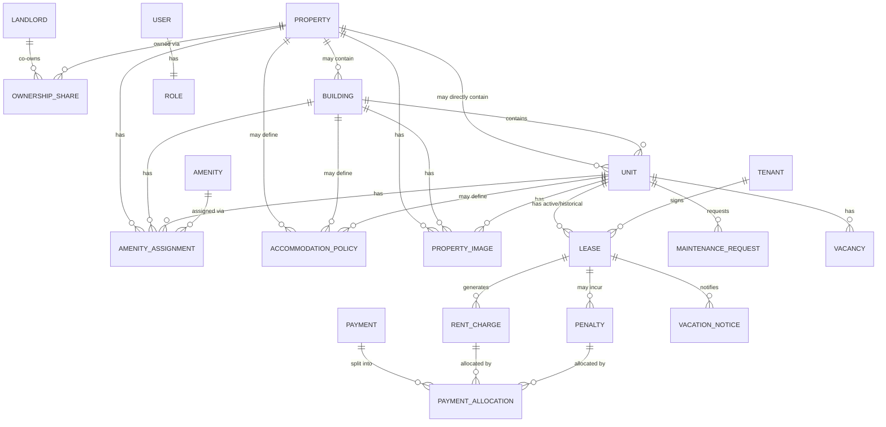

# Domain Model

Conceptual domain model for the platform. This document describes
entities, relationships and invariants. Physical tables are in
`data-model.md`; enforcement rules are in
`../requirements/business-rules.md`.

## Bounded Contexts

1. **Identity & Access** – users, roles, authentication, authorization.
2. **Portfolio & Tenancy** – landlords, properties, units, tenants,
   leases.
3. **Billing & Ledger** – rent charges, payments, allocations,
   penalties, arrears (derived).
4. **Operations** – maintenance, vacation notices, vacancy.
5. **Reporting & Audit** – statements, audit log.

Modules must not be coupled across contexts except through explicit,
controlled references.

## Entities

### Identity & Access

- **User** – authentication principal (email, password hash, status).
  Has one **Role**.
- **Role** – `ADMIN`, `LANDLORD`, `PROPERTY_MANAGER`, `TENANT`.
- **Session** – server-side session for a user (pending ADR-004).

### Portfolio & Tenancy

- **Landlord** – owner of properties. `kind` = `INDIVIDUAL` |
  `CORPORATE`. Corporate landlords may have multiple authorized users.
  Holds one or more **OwnershipShare** records when a property has
  multiple owners.
- **Property** – a building/estate; belongs to a Landlord (or co-owned).
  Optional GPS location. May contain **Buildings** and/or **Units**
  directly.
- **Building** – optional physical block within a Property. A Property
  may have many buildings; a standalone property has none and its units
  hang directly off the Property.
- **Unit** – a rentable unit within a Property (or Building); has a
  standard rent, optional bedroom/bathroom counts (only where
  meaningful) and tenancy history.
- **Amenity** – reusable catalogue record (`key`, name, category
  `FEATURE`/`AMENITY`/`UTILITY`, active flag). Assigned to a property,
  building or unit through **AmenityAssignment** (`INCLUDE`/`EXCLUDE`).
  Effective amenities are derived by inheritance, not copied.
- **PolicyDefinition** – reusable catalogue record (`key`, name,
  `value_type` = `BOOLEAN`/`ENUM`/`INTEGER`/`TEXT`, `enum_values`).
  Assigned through **PolicyAssignment** (`SET`/`EXCLUDE`) with a typed
  value. Covers gender policy, student/family/children/pets/smoking/shared
  eligibility, visitors policy and max occupants.
- **InventoryImage** – provider-neutral photo reference (storage
  provider/key, MIME type, size, dimensions, filename, caption, sort
  order, `is_primary`, soft-delete + cleanup status). No binaries in DB.
- **Tenant** – a person occupying a unit.
- **Lease** – tenancy agreement linking a Tenant to a Unit for a term
  with agreed rent and deposit terms (versioned over time; historical
  terms are never overwritten).

### Billing & Ledger

- **RentCharge** – amount due for a Lease for a specific period.
- **Payment** – money received (method, amount, external reference).
- **PaymentAllocation** – links a Payment to a charge (rent/fee/
  penalty), recording the allocated amount.
- **Penalty** – an additional charge applied under an approved rule.
- **Arrears** – *derived*, not stored: outstanding charges minus
  allocations.

### Operations

- **MaintenanceRequest** – internal maintenance job for a unit/property.
- **VacationNotice** – tenant notice of intended absence.
- **Vacancy** – a period during which a unit is unoccupied.

### Reporting & Audit

- **Document** – private tenant/property document (access-restricted).
- **AuditLog** – record of sensitive/administrative actions.
- **Notification** – message to a user (in-app/email/SMS).

## Relationships

## Aggregates

- **Tenancy aggregate**: Lease + its RentCharges + Penalties.
- **Payment aggregate**: Payment + its PaymentAllocations.
- **Property aggregate**: Property + Buildings + Units + Amenity
  assignments + AccommodationPolicies + PropertyImages.
- **Ownership aggregate**: Landlord + OwnershipShares for a property.

## Value Objects

- **Money** – `{ amount: Decimal, currency: "KES" }`. Exact arithmetic
  only (see BR-MONEY-*). Never a JS `number` for calculations.
- **Period** – a billing period (e.g. `2026-04`).
- **DateRange** – start/end for leases, notices, vacancies.
- **GeoPoint** – `{ lat: Decimal, lng: Decimal }`, optional; parsed and
  validated from common input formats (e.g. `-1.2921, 36.8219`).
- **ImageRef** – `{ storage_key, caption?, is_primary, sort_order,
  uploaded_at }`; binary storage is external to the relational DB.

## Key Invariants

1. A Unit has **at most one active Lease** at any time.
2. The sum of a Payment's allocations **cannot exceed** the payment
   amount (no over-allocation).
3. Balances are **derived** from charges minus allocations; there is no
   authoritative mutable balance field.
4. Ledger records (charges, payments, allocations, penalties) are
   **append-only**; corrections create new linked records.
5. Every Payment has at most one successful allocation per charge and is
   idempotent on external reference.
6. RentCharge generation for a (lease, period) is idempotent.
7. A Penalty exists only under an **approved, versioned** rule
   (BR-PEN-003).
8. A Unit belongs to exactly one container: either a Property directly
   or a Building (which belongs to a Property). A Property may have zero
   or more Buildings and still have Units directly.
9. Amenities and accommodation policies are assigned at property,
   building or unit level from reusable catalogues. More-specific
   assignment does not delete less-specific ones; `EXCLUDE` explicitly
   stops inheritance and differs from having no assignment.
10. The effective amenity/policy set for a target is **derived** from the
    property → building → unit chain at read time; values are never copied
    into child rows.
11. An `InventoryImage` set for any level has at most one active
    `is_primary` row (partial unique index ignoring soft-deleted rows).
11. Rent and deposit terms on a Lease are versioned; changing terms
    appends a new term record and never overwrites historical charges.

## Notes

- Arrears, tenant payment behaviour and statements are **read models**
  derived from the ledger, not stored mutable state.
- Exact storage types, indexes and constraints are specified in
  `data-model.md`.