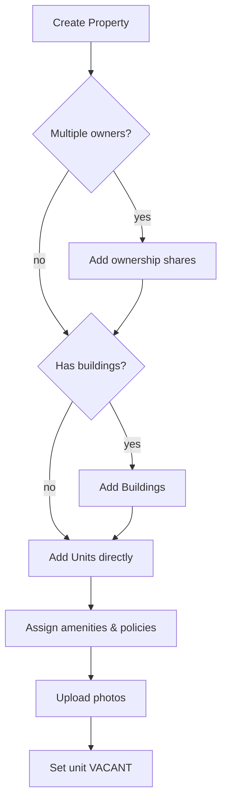
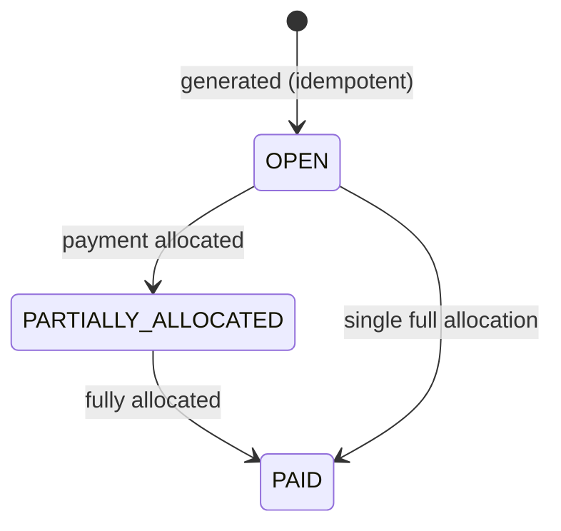
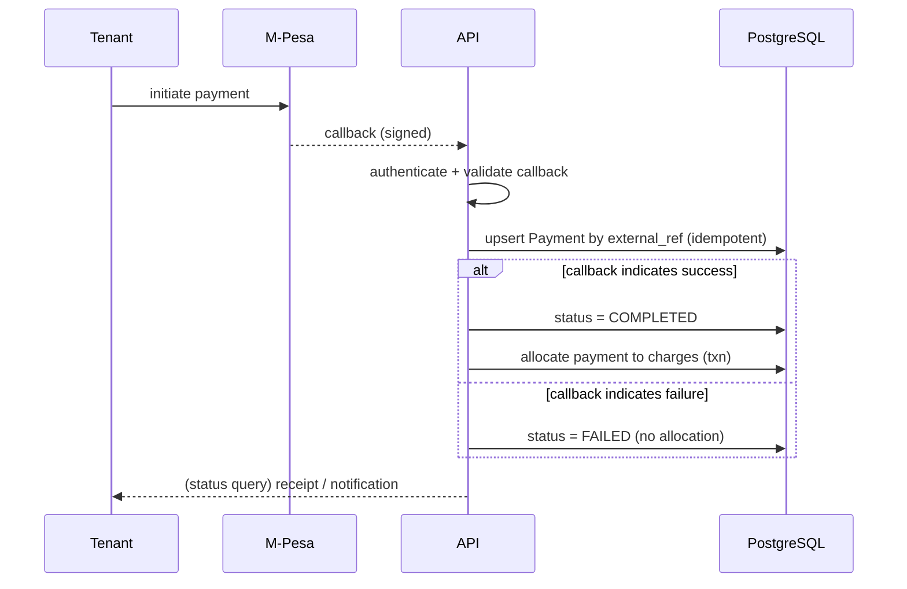

# System Workflows

End-to-end workflows describing actor, steps and outcomes. Money-moving
steps reference the ledger rules in
`../requirements/business-rules.md`. Steps marked **Pending** depend on
an approved decision and must not be automated until approved.

## 1. User Onboarding

**Actor:** ADMIN (invites), invitee (accepts).

1. ADMIN creates a user with role and (for managers) assigned scope.
2. System creates an `INVITED` user and sends an invite (mechanism per
   ADR-004).
3. Invitee sets a password; account becomes `ACTIVE`.
4. Onboarding is recorded in `audit_logs`.

## 2. Property & Unit Setup

**Actor:** LANDLORD / PROPERTY_MANAGER.

1. Create Property (primary ownership → landlord; optional co-owners via
   ownership shares; optional GPS location parsed/validated).
2. Optionally add Buildings (e.g. "Block A"); a standalone property
   skips this step.
3. Add Units with standard rent and optional bedroom/bathroom counts;
   each unit attaches to a building or directly to the property.
4. Set unit status (`VACANT`).
5. Assign amenities and accommodation policies at property/building/unit
   level as needed.
6. Upload photos (external storage); set caption, primary flag and
   display order.

## 3. Tenant Onboarding & Lease

**Actor:** PROPERTY_MANAGER / LANDLORD.

1. Create Tenant (name, phone, restricted national ID).
2. Create Lease for a `VACANT` unit (term, rent). Unit → `OCCUPIED`.
3. Invariant: only one `ACTIVE` lease per unit (partial unique index).

## 4. Rent Charge Generation

**Actor:** system (scheduled) / PROPERTY_MANAGER.

1. For each active lease, generate a `RentCharge` for the period
   (idempotent on `lease_id + period`).
2. Charge starts `OPEN`.
3. Preview of upcoming charges is a derived read model.

## 5. Payment via M-Pesa

**Actor:** TENANT (pays), system (records), staff (reconciles).

1. Tenant initiates payment (STK Push / Paybill — mechanism **Pending**
   M-Pesa confirmation).
2. Provider calls the backend callback; backend **authenticates and
   validates** the callback (BR-PAY-002).
3. Backend records a `Payment` keyed by `external_ref` (idempotent —
   duplicate callbacks are ignored via unique constraint).
4. Payment `PENDING` → `COMPLETED` on success.
5. Payment is allocated to charges (workflow 6).
6. A notification (SMS/in-app) is sent to the tenant/manager; **SMS is
   a notification only and never a financial source of truth.**

### Failure & reconciliation paths

- **Failed transaction:** status `FAILED`; no allocation; tenant and
  manager notified; charge remains open.
- **Reversal / refund:** recorded as a **new linked entry** (reversal
  row referencing the original); original payment is never edited or
  deleted (BR-PAY-005). Any allocations are reversed with linked rows.
- **Duplicate/late callback:** ignored if `external_ref` already exists;
  reconciliation matches by `external_ref`/amount/date.
- **Unmatched payment:** recorded `COMPLETED` but unallocated; surfaced
  in a reconciliation queue for manual allocation (BR-PAY-003).
- **Provider reconciliation report:** (if available) ingested to confirm
  ledger vs provider totals; discrepancies flagged, never silently
  adjusted.

## 6. Payment Allocation (order **Pending**)

1. Within a single transaction, allocate a `COMPLETED` payment to
   outstanding charges as `PaymentAllocation` rows.
2. Sum of allocations ≤ payment amount (no over-allocation).
3. **Allocation order** across rent / fees / penalties is **Pending**
   approval (BR-PAY-004) — not implemented from assumptions.
4. Fully allocated charges become `PAID`.

## 7. Arrears Detection

**Actor:** system.

1. Derive outstanding balance per lease = open charges − allocations.
2. Surface aging buckets (current, 1–30, 31–60, 60+ days).
3. Arrears are a read model; no mutable balance stored.

## 8. Penalty Application (**Pending ADR-006**)

1. Determine overdue charges per the approved rule.
2. Compute penalty using the **approved, versioned** rule only
   (BR-PEN-003/005).
3. Create a `Penalty` record and (optionally) a charge for allocation.
4. **No formula is applied until ADR-006 is approved.**

## 9. Maintenance

1. Tenant/manager raises a `MaintenanceRequest` for a unit.
2. Status moves `OPEN → IN_PROGRESS → DONE`.
3. Linked to unit/property; visible per permissions matrix.

## 10. Vacation Notice & Vacancy

1. Tenant submits a `VacationNotice` (dates) for their lease.
2. When a unit becomes unoccupied, a `Vacancy` period is recorded.
3. Reports show vacant units and durations.

## 11. Reporting

1. Reports (statements, arrears, collections) are computed from ledger
   records (never from a mutable balance).
2. Landlord statements are scoped to the landlord's properties.
3. Every report is reproducible from source records.

## 12. Audit & Corrections

1. Sensitive actions (refunds, corrections, config) write `audit_logs`.
2. Financial corrections append new linked records; nothing is silently
   deleted (BR-LEDGER-005/006).
3. Audit entries capture actor, action, entity and before/after summary.

## Cross-Cutting Requirements

- **Idempotency:** rent-charge generation and M-Pesa callbacks must be
  safe to retry.
- **Transactions:** payment+allocation and charge-generation are atomic.
- **Authorization:** every step checks role **and** scope (see
  `permissions-matrix.md`).